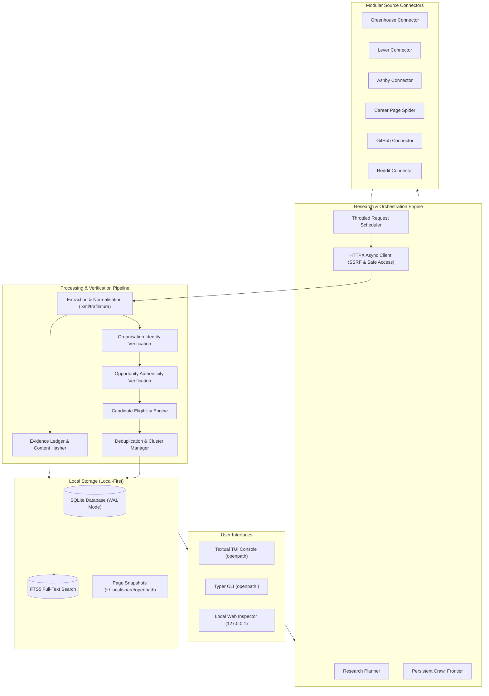

# OpenPath Architecture Decision Record & System Architecture
**Version 1.0 | Component Design & Stack Selection**

---

## 1. Technology Stack Decisions (ADR)

| Component | Selected Technology | Version Baseline | Rationale & Alternatives Rejected |
|---|---|---|---|
| **Language** | Python | `>= 3.13` (tested on 3.14) | Standard modern Python with strict type annotations, standard library improvements, and robust asynchronous concurrency. |
| **Package Manager** | `uv` | `>= 0.5` | Fast, deterministic resolution, integrated virtual environment management, and strict lockfile pinning (`uv.lock`). |
| **Terminal Interface** | `Textual` | `>= 8.0` | Rich asynchronous TUI framework providing interactive data tables, progress monitors, keyboard bindings, and modal inspectors. |
| **CLI Framework** | `Typer` | `>= 0.15` | Type-annotated, ergonomic CLI parser generating clean help screens, rich diagnostic output, and testable command functions. |
| **Asynchronous Network** | `HTTPX` | `>= 0.28` | Pure-Python asynchronous HTTP client with HTTP/1.1 and HTTP/2 support, connection pooling, proxy support, and fine-grained timeout controls. |
| **HTML / Text Extraction** | `lxml` + `trafilatura` | `lxml >= 5.3`, `trafilatura >= 2.0` | High-performance C-based XML/HTML parsing paired with battle-tested boilerplate removal and readable body text extraction. |
| **Data Validation** | `Pydantic` | `v2.10+` | Rust-backed fast schema validation, serialization, and strict type enforcement for opportunity records and candidate profiles. |
| **Browser Fallback** | `Playwright` | `>= 1.50` (optional) | Headless Chromium automation used strictly as a fallback for dynamic JavaScript-rendered career sites. |
| **Database** | SQLite + FTS5 | System SQLite (WAL mode) | Portable, local-first database requiring zero daemon management, zero network overhead, full transactional ACID safety, and full-text search. |
| **Linter & Formatter** | `Ruff` | `>= 0.9` | Extremely fast Python linter and formatter configured for strict adherence to modern PEPs and code hygiene. |
| **Type Checker** | `Pyright` | `>= 1.1.390` | Standard/strict static type analysis ensuring type safety across all internal interfaces and models. |
| **Test Framework** | `pytest` + `pytest-asyncio` | `pytest >= 8.3` | Async-capable unit, integration, and mocking harness with fixture isolation. |

---

## 2. System Architecture

---

## 3. Component Details & Principles

### A. Persistent Frontier & Scheduler
- Crawl tasks are tracked in the database with explicit states: `discovered`, `queued`, `fetched`, `parsed`, `skipped`, `blocked`, `failed`, `retry_pending`.
- Per-domain and per-provider concurrency limits prevent slamming remote servers.
- Exponential backoff with jitter and `Retry-After` header adherence.

### B. Security & Safe Network Boundary
- Every target URL is validated before requesting and after any HTTP redirects.
- Private IP ranges (`10.0.0.0/8`, `172.16.0.0/12`, `192.168.0.0/16`, `127.0.0.0/8`), IPv6 loopback (`::1`), link-local (`169.254.0.0/16`), and cloud metadata services (`169.254.169.254`) are strictly blocked to prevent SSRF.
- Maximum payload limits (e.g. 10MB per page) prevent memory exhaustion.

### C. Evidence Store
- Every opportunity fact (title, company, description, apply URL, location, compensation) is tied to an `EvidenceRecord` containing the source URL, HTTP status, retrieval timestamp, content hash (SHA-256), and raw excerpt.
- Inferences and unbacked assertions are forbidden.

### D. Verification & Eligibility Separation
- Verification determines whether the opportunity genuinely exists and is accepting applications.
- Eligibility determines whether a given candidate meets the stated criteria (degree, graduation year, experience, skills, India authorization).
- A verified opportunity is preserved even if the candidate is not eligible or eligibility is unclear.
