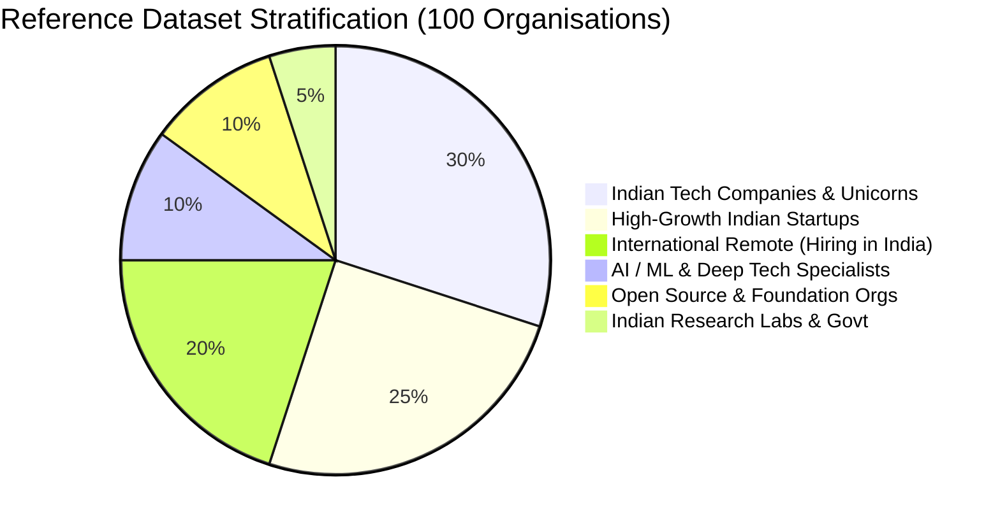

# OpenPath Research Benchmark & Evaluation Plan
**Version 1.0 | Quantitative Metrics & Acceptance Standards**

---

## 1. Evaluation Methodology

OpenPath must be evaluated as a scientific research instrument, not an arbitrary web scraper. Success is measured by **evidence completeness, precision, and fraud resistance**, rather than sheer unverified listing counts.

### Core Benchmark Objective
Achieve **$\ge 98\%$ verified precision** on a stratified, independently labelled reference test suite of ~100 organizations, with zero fabricated or fraudulent opportunities admitted into the `VERIFIED` feed.

---

## 2. Stratified 100-Organisation Reference Dataset

The reference set represents the spectrum of technical hiring accessible to Indian students and early-career engineers:

### Representative Sample:
1. **Indian Tech Enterprises & Unicorns (30):**
   - Groww, Slice, Meesho, CRED, Razorpay, PhonePe, Swiggy, Zomato, Zerodha, Flipkart, InMobi, Freshworks, Postman, BrowserStack, Zoho, etc.
2. **High-Growth Startups & Developer Platforms (25):**
   - Atlan, Hasura, Appsmith, SigNoz, Dyte, QuestDB, Locofy, Devrev, DhiWise, etc.
3. **International Remote Hiring in India (20):**
   - GitLab, Canonical, Automattic, Red Hat, Elastic, Supabase, PostHog, DuckDuckGo, Sourcegraph, etc.
4. **AI/ML & Data Engineering Specialists (10):**
   - Sarvam AI, Krutrim, Arya.ai, Wadhwani AI, Yellow.ai, Hugging Face, etc.
5. **Open Source & Developer Foundations (10):**
   - Apache Software Foundation, Linux Foundation, Python Software Foundation, Mozilla, CNCF, GSoC orgs.
6. **Research Institutions & Government (5):**
   - IISc, IIT Research Parks, CSIR, AICTE Internship Portal, National Career Service.

---

## 3. Quantitative Evaluation Metrics

Every research run outputs a standardized benchmark scorecard:

| Metric | Definition | Target |
|---|---|---|
| **Discovery Recall** | Percentage of genuine, active openings discovered from the declared source inventory. | $\ge 90\%$ |
| **Verified Precision** | Percentage of records marked `VERIFIED` that are genuine, active, authorized, and India-accessible. | $\ge 98\%$ |
| **Company Verification Accuracy** | Percentage of corporate domains correctly matched to registered legal entities or authoritative brands. | $\ge 99\%$ |
| **Opportunity Authenticity Accuracy** | Accuracy in verifying active vs closed/filled job postings. | $\ge 95\%$ |
| **Eligibility Precision** | Accuracy in categorizing candidate requirements without false positives (e.g. no assuming 0 years when experience is unspecified). | $100\%$ (Zero speculative inference) |
| **India-Accessibility Accuracy** | Correct classification of whether Indian residents are eligible to apply. | $\ge 98\%$ |
| **Duplicate Survival Rate** | Percentage of true duplicate postings that escape deduplication. | $< 2\%$ |
| **Expired Listing Detection** | Percentage of inactive/closed positions identified and kept out of the active feed. | $\ge 95\%$ |
| **Evidence Completeness** | Percentage of verified claims with full traceability (URL, timestamp, hash, verbatim excerpt). | $100\%$ |
| **Request Efficiency** | Average network requests and bandwidth utilized per verified opportunity. | Minimal, strictly bounded |

---

## 4. Adversarial Test Suite

The test suite includes dedicated adversarial test cases to confirm verification gates reject invalid data:
1. **Impersonator Listing:** Fake company domain attempting to mimic a legitimate unicorn (e.g., `cred-careers.jobs` vs `cred.club`). Must be flagged `NEEDS_INVESTIGATION` or `REJECTED`.
2. **Expired Post:** Valid Greenhouse job URL that displays "This job is closed" or redirects to a generic jobs board. Must fail `current_availability`.
3. **False Remote:** Role titled "Remote Software Engineer" with description stating "Must reside in California, USA". Must fail `india_accessibility`.
4. **Missing Academic Year:** Entry-level post mentioning "Intern" without specifying graduation year. Eligibility evaluator must report `academic_year = UNKNOWN`, never assuming all years are eligible.
5. **Suspicious Application Link:** Opportunity on a legitimate domain linking to an unverified third-party telegram group or payment portal. Must fail `application_destination`.
