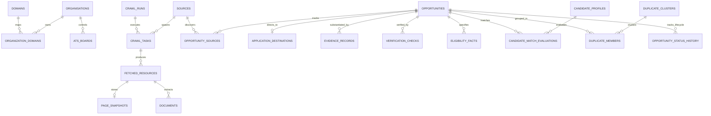

# OpenPath Local Data Model & Entity Specifications
**Version 1.0 | SQLite Relational Schema & Invariants**

---

## 1. Relational Entity Overview

OpenPath persists all data in a local SQLite database configured with:
- `journal_mode = WAL` (Write-Ahead Logging for high concurrent read performance)
- `foreign_keys = ON` (Strict relational integrity)
- `busy_timeout = 5000` (5-second timeout for lock acquisition)
- Single-writer managed connection to prevent database locking conflicts.

---

## 2. Entity Definitions

### 1. `candidate_profiles`
Stores structured profiles for candidates.
- `id` (TEXT PRIMARY KEY): Stable UUID.
- `name` (TEXT NOT NULL): Profile label (e.g., "Default CSE 3rd Year").
- `eligibility_json` (TEXT): Degree, current academic year, graduation year, work authorization.
- `skills_json` (TEXT): Explicit technical skills array (`["Python", "FastAPI", "PostgreSQL"]`).
- `languages_json` (TEXT): Programming languages array.
- `specialisations_json` (TEXT): Focus areas (`["Backend", "Distributed Systems"]`).
- `preferences_json` (TEXT): Work modes (`remote`, `hybrid`, `onsite`), preferred cities.

### 2. `source_connectors`
Registered connector plugins.
- `id` (TEXT PRIMARY KEY): e.g. `ats.greenhouse`, `ats.lever`, `ats.ashby`.
- `kind` (TEXT NOT NULL): `greenhouse`, `lever`, `ashby`, `web_spider`, `github`, `reddit`.
- `version` (TEXT NOT NULL): Connector code version.
- `enabled` (INTEGER 0/1).

### 3. `sources`
Specific target sources or endpoints configured within a connector.
- `id` (TEXT PRIMARY KEY): e.g. `ats.greenhouse.groww`.
- `connector_id` (TEXT REFERENCES source_connectors).
- `name` (TEXT NOT NULL): Source display name.
- `category` (TEXT NOT NULL): `ats`, `official`, `community`, `institutional`.
- `base_url` (TEXT): Endpoint URL.
- `authority_tier` (TEXT): `official`, `ats`, `community`, `aggregator`, `registry`, `unknown`.
- `metadata_json` (TEXT): Board tokens, company slugs, and regional scopes.

### 4. `organisations` & `domains` & `organization_domains`
Tracks corporate identity, registered domains, and employer relationships.
- Resolves domain names to corporate legal entities and validates whether an ATS board is legitimately authorized by the domain owner.

### 5. `ats_boards`
Registry of discovered and verified employer ATS boards.
- `provider`: `greenhouse`, `lever`, `ashby`, etc.
- `board_token`: ATS identifier slug.
- `base_url`: Canonical API/board URL.

### 6. `crawl_runs` & `crawl_tasks` & `fetched_resources`
Resumable frontier and crawl execution logs.
- `task_type`: `seed`, `sitemap`, `board_listing`, `job_detail`, `document`.
- `state`: `discovered`, `queued`, `fetched`, `parsed`, `skipped`, `blocked`, `failed`, `retry_pending`.
- `fetched_resources`: Stores HTTP status, response headers, content type, SHA-256 hash, and payload size.

### 7. `opportunities`
Canonical opportunity records.
- `id` (TEXT PRIMARY KEY): Stable hash or UUID.
- `organization_id` (TEXT REFERENCES organisations).
- `title` (TEXT NOT NULL): Clean job title.
- `opportunity_type` (TEXT): `internship_paid`, `internship_unpaid`, `fresher_fulltime`, `entry_level`, `research`, `fellowship`, `hackathon`, `open_source`.
- `location_raw` & `location_normalized`: Original vs parsed location.
- `work_mode`: `remote`, `hybrid`, `onsite`, `unclear`.
- `india_eligible`: `1` (Confirmed), `0` (Excluded), `NULL` (Unknown).
- `description_text`: Clean plain text extracted via Trafilatura.
- `compensation_raw`: Disclosed salary/stipend or `"Not disclosed"`.
- `status`: `discovered`, `verified`, `needs_investigation`, `community_lead`, `rejected`, `expired`, `closed`.

### 8. `evidence_records`
Immutable evidence trails supporting claims.
- `id` (TEXT PRIMARY KEY): UUID.
- `opportunity_id` (TEXT REFERENCES opportunities).
- `evidence_type`: `html_excerpt`, `api_json_field`, `pdf_page`, `document_quote`.
- `claim`: Specific claim verified (`title`, `company_identity`, `india_accessibility`, `stipend`).
- `original_url` & `canonical_url`: Verifiable retrieval source.
- `content_hash`: SHA-256 hash of original content.
- `excerpt`: Verbatim text supporting the claim.

### 9. `verification_checks`
Individual test outcomes for each gate.
- `check_name`: `company_identity`, `source_authority`, `listing_existence`, `application_destination`, `current_availability`, `india_accessibility`.
- `result`: `PASS`, `FAIL`, `UNKNOWN`.
- `explanation`: Human-readable justification.
- `evidence_id`: Link to supporting `evidence_records`.

### 10. `eligibility_facts` & `candidate_match_evaluations`
- `eligibility_facts`: Stores extracted requirements (`degree = B.Tech`, `year = 3rd or 4th year`, `experience = 0-1 years`).
- `candidate_match_evaluations`: Evaluates candidate profile against facts with 4-way outcome: `CONFIRMED_ELIGIBLE`, `CONFIRMED_INELIGIBLE`, `UNCLEAR`, `MORE_INFO_REQUIRED`.

### 11. `duplicate_clusters` & `duplicate_members`
Deduplication clusters grouping identical listings across multiple discovery channels while preserving provenance and individual source links.

### 12. `opportunity_fts` (SQLite FTS5)
Virtual table indexing `title`, `description_text`, and `skills` for fast, ranked full-text queries within the TUI and CLI.
