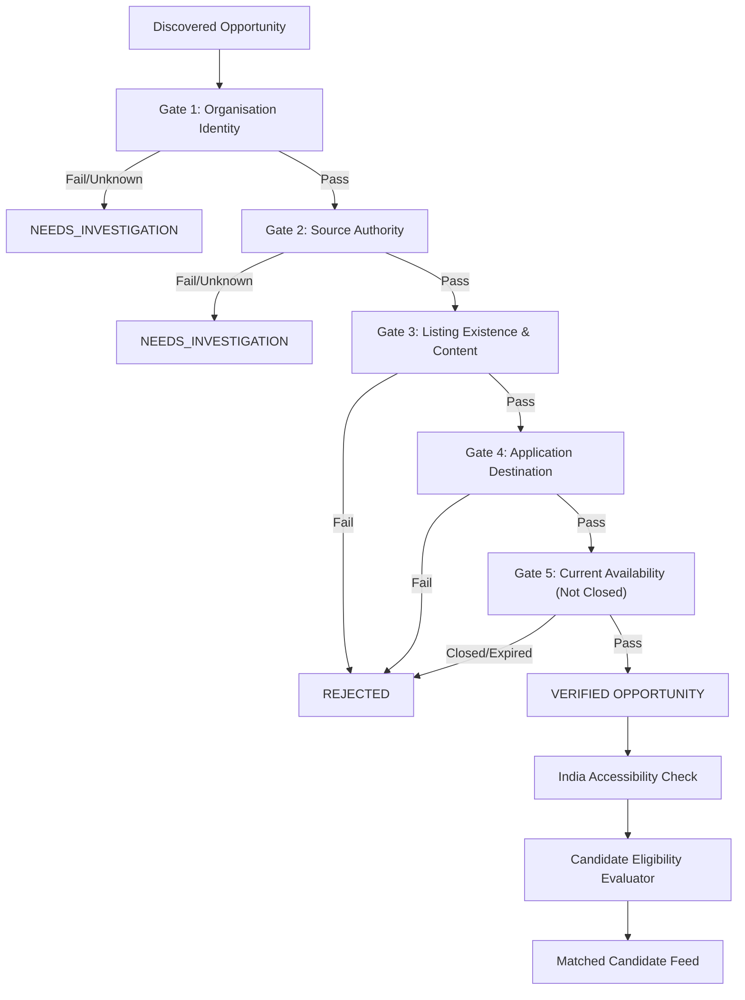

# OpenPath Verification & Admission Policy
**Version 1.0 | Rigorous Evidence Standards & Admission Gates**

---

## 1. Admission Policy Overview

OpenPath rejects the philosophy of blind job aggregation. An opportunity is presented to candidates only when backed by reproducible evidence.



---

## 2. The Four Primary Classifications

### 1. `VERIFIED`
All mandatory gates pass with authoritative primary evidence:
- **Organisation Identity:** PASS (Domain belongs to registered or verifiable corporate entity).
- **Source Authority:** PASS (Source is official website, verified ATS board, or authorized partner).
- **Listing Existence:** PASS (Page/API returns full job details, title, and description).
- **Application Destination:** PASS (Apply URL directs to company careers form or ATS endpoint).
- **Current Availability:** PASS (No "closed", "position filled", or past deadline indicators).

### 2. `NEEDS_INVESTIGATION`
The listing appears promising, but one or more mandatory facts are unconfirmed:
- Domain registration cannot be tied to company.
- Requisition status is ambiguous or requires deeper manual confirmation.
- The opportunity remains in the investigation database and is excluded from the verified feed.

### 3. `COMMUNITY_LEAD`
The opportunity was discovered in a community post (Reddit, GitHub discussion, technical forum):
- Serves strictly as a research lead.
- Connectors attempt to resolve the lead to an official company or ATS posting.
- If no official posting exists, it remains labelled `COMMUNITY_LEAD` and is never displayed as a verified role.

### 4. `REJECTED`
Any listing meeting any of the following criteria:
- Fraudulent or impersonation attempt (e.g. asking for application fees, unofficial email domains).
- Position closed, expired, or removed.
- Completely out of technical scope (e.g. non-engineering, sales, telemarketing).
- Destination URL broken, redirecting to spam, or requiring paid third-party unlocks.

---

## 3. Mandatory Independent Verification Checks

Every opportunity evaluated by OpenPath records an individual result for each check:

| Check Name | Target Dimension | Pass Criteria | Fail / Unknown Criteria |
|---|---|---|---|
| `company_identity` | Organisation existence & domain control | Domain matches verified brand, official WHOIS, or corporate registry. | Disposable domain, spoofed company name, or unverified new domain. |
| `source_authority` | Authority of the publishing source | Published directly on official site, official ATS board, or verified partner. | Unofficial forum, aggregator repost, unconfirmed third-party portal. |
| `listing_existence` | Genuine job opening content | Verifiable title, clear job responsibilities, technical requirements. | Empty page, placeholder listing, generic clickbait title. |
| `application_destination` | Integrity of application target | URL resolves to employer-controlled ATS or secure company domain. | Suspicious Google Form without official domain link, affiliate link, paid registration wall. |
| `current_availability` | Active application status | Page contains active apply action; no text matching "Closed", "Archived", "No longer accepting applications". | Past deadline, HTTP 404/410, page explicit "Position Filled" banner. |
| `india_accessibility` | Accessibility for Indian residents | Location explicitly includes India, Bangalore/Hyderabad/Delhi/remote India, or global remote open to India. | Explicit US-only, EU-work-authorization required, or excludes Indian timezone/residency. |

---

## 4. Separation of Opportunity Validity and Candidate Eligibility

**Crucial Invariant:** Opportunity verification and candidate eligibility are completely decoupled dimensions.

```
Example Evaluation Result:
- company_identity:        PASS
- source_authority:        PASS
- listing_existence:       PASS
- application_destination: PASS
- current_availability:    PASS
- india_accessibility:     PASS
-------------------------------------------
=> Overall Opportunity Status: VERIFIED

Candidate Specific Evaluation:
- academic_year:           UNKNOWN (no year mentioned in post)
- degree_match:            PASS (B.Tech / B.E. accepted)
- experience_match:        PASS (0-1 years required; candidate has 0)
- skills_match:            PASS (Python, SQL required; candidate has both)
-------------------------------------------
=> Candidate Match Status: UNKNOWN (Academic year unverified)
```

**Rule:** Never tell a candidate that their eligibility is `CONFIRMED` when an eligibility requirement is missing from the job description. Report what is confirmed and what remains unknown.
